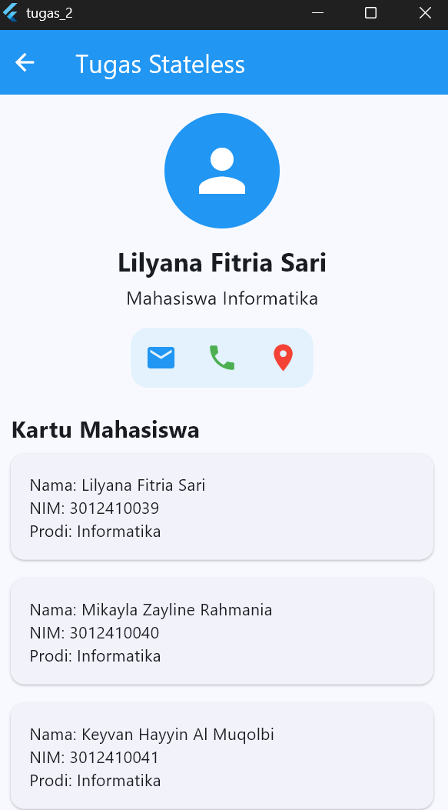
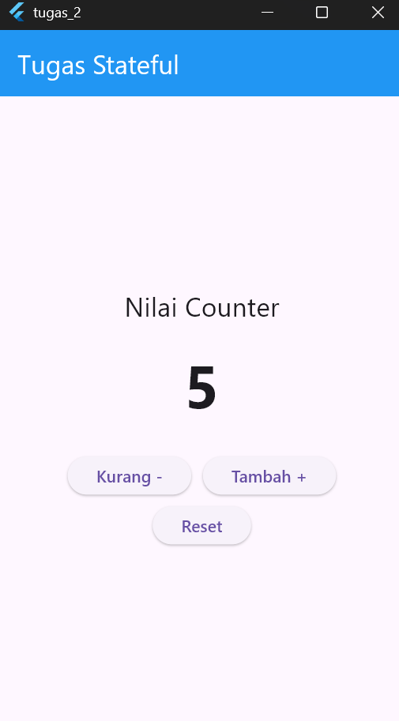

# Tugas 2 Flutter

## 1. Hasil Stateless

Berikut adalah hasil tampilan halaman Stateless yang berisi profil mahasiswa dan kartu mahasiswa.

## 2. Hasil Stateful

Berikut adalah hasil tampilan halaman Stateful yang memiliki tombol tambah, kurang, dan reset.

